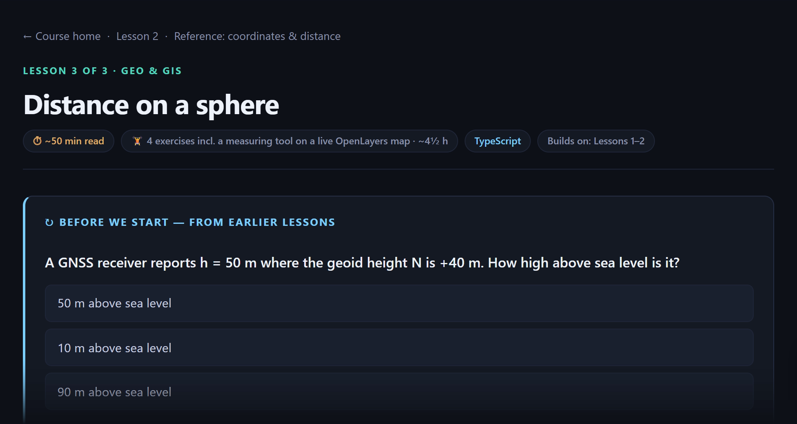
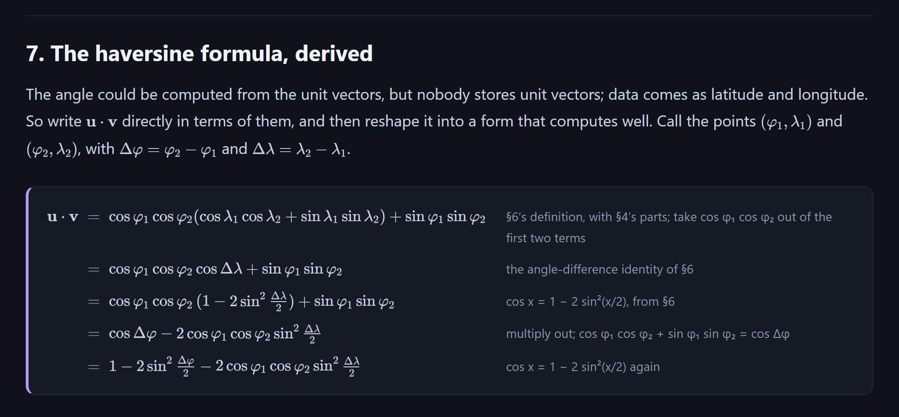
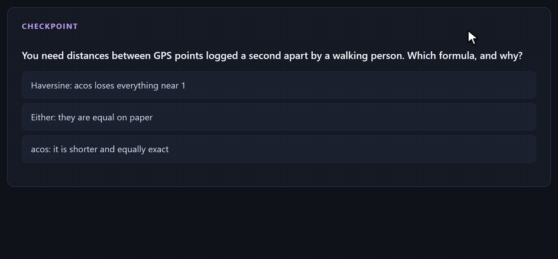
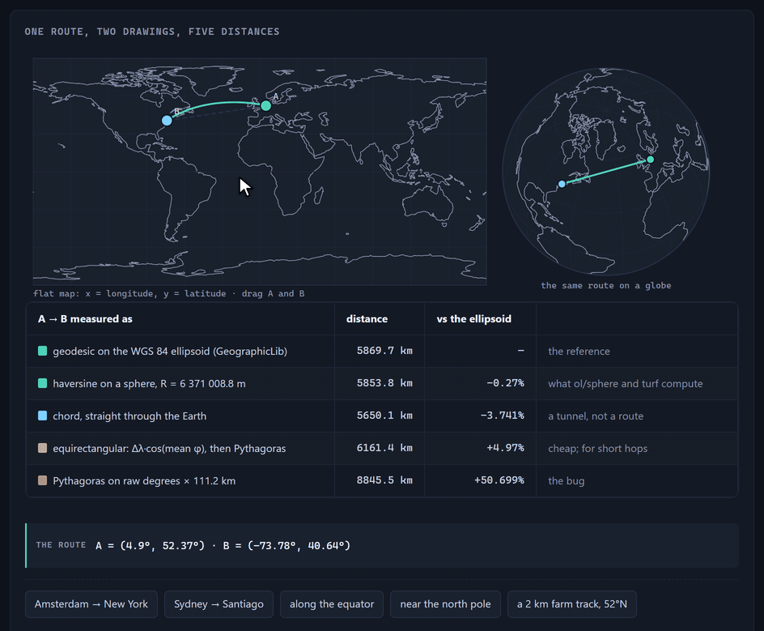

# teachkit

`/teach` is a skill for AI coding agents that turns the agent into a personal teacher. You name a
topic and it interviews you. Then it writes you a course of long, carefully explained lessons with
interactive figures, quizzes and real exercises, served as a small website on your own machine.

Each course is written for one person. It starts from what you already know, aims at what you want
to be able to do, and stays inside the scope you set. The agent also has to check what it writes:
every claim about how something behaves is backed by a source it fetched or settled by code it ran.

The skill has been in use for four months on a dozen courses, about 80 lessons in all. The subjects
include C, Rust, Go, Android, data structures, Linux, mathematics, GIS and system design. Most of
its rules exist because something went wrong in one of those courses.



## What a lesson looks like

A lesson is one page of the course site, usually a 35–50 minute read. It has:

- an opening built on a problem you already have, then the idea, then the mechanism one step at a
  time, with the arithmetic written out rather than waved through with "clearly";
- figures drawn as real graphics, interactive where the movement is the point: step through a sort
  and watch its comparison counter, or drag a parameter and watch what it changes;
- short checkpoint quizzes through the page, which you retry until you get them right, and three
  recall questions from earlier lessons at the top;
- four substantial exercises, usually starter files and a prepared test suite in a repository of
  yours, with hints and a worked solution;
- one primary source to read, further reading, and an "ask your teacher" box that names the parts
  most likely to be unclear.

A derivation, with every step written out and the reason for it beside it:



A checkpoint, answered wrong twice and then right. The explanation only appears once you get there:



Next to the lessons, the course folder keeps your mission (why you are learning this), the sources
the course trusts, a glossary, records of what you have actually demonstrated, and a notes file.
Every lesson that failed to land goes into the notes, along with what was changed because of it.

## Why it is worth a look

### It checks its own claims

The usual problem with an AI teacher is that it says something plausible and wrong, and a learner
has no way to tell. Here, checking is part of writing. Before a lesson ships, the agent has to:

- fetch every source it cites, because a URL that looks right is not proof that the page exists;
- back each claim about behaviour, cost or memory with a source that states it outright, or with
  code it ran;
- solve its own exercises, run the tests against the reference solutions and against the empty
  starter files, and, for every sentence of the form "this mistake fails that test", make that
  mistake on purpose and run the tests;
- build the site, crawl every page for broken links and rendering errors, and look at the result.

If you want, a second agent that has seen none of the writing then reads the lesson in order, the
way you will, and reports everything it would have stopped on. In one course that second read
found 28 problems in three lessons that every other check had passed.

It still gets things wrong sometimes. In one Android lesson the page said a broken counter would
show 0; when the agent pressed the button for real it showed 3, so the example was rewritten and
the page now shows what was measured. When you find a mistake yourself, the fix goes into the lesson
as a visible correction, and whatever caused it becomes a rule for the lessons after it.

### It is interactive by default

Because the course is a web app, a figure can be anything a browser can draw. The skill comes with
about thirty figure components (arrays, linked lists, trees, memory layouts, timelines, aligned
step-by-step derivations) and a dozen interactive labs. In the interview the agent proposes figures
for your particular topic and you choose which to build. When a lesson needs a shape that does not
exist yet, the agent builds a new component, so the next lesson gets it for free.

The route lab from the GIS course, with one end dragged from New York to Seattle, Cape Town and
Sydney:



The labs run the real thing. A hashing lab computes the same hash the lesson teaches, and a
recursion tree is generated by actually recursing. There are about fifty labs across the courses
so far. Among them are an Amsterdam to New York flight you can drag around a flat map (the shortest
route curves there, and runs straight on the globe beside it), a lifecycle stepper that replays
recordings from a real Android device, and a boot timeline taken from the learner's own laptop.
The skill also has a rule against decoration: interaction is used where the movement is the
lesson, and nowhere else.

### It is written for you

There is no fixed syllabus. The first session is an interview: why you want this, what you already
know, what is out of scope, which languages, where you want to practise, how long lessons should
be. Everything after that follows from your answers, so it works from zero and it works for going
past what you already know. Some examples from real courses:

- A Go course from a first program to the scheduler, the garbage collector and a working web API,
  in 23 lessons.
- A Svelte course for an experienced React developer. It skips everything React already taught and
  covers only the difference, with React comparisons where they help.
- A GIS course for someone who builds map features at work. It goes underneath the mapping
  libraries they use every day: what each one computes, how far off it can be, and the formulas
  behind it, derived rather than memorised.
- A Linux course taught on the learner's own laptop. Its lessons quote that machine's real output,
  collected over read-only SSH, down to the boot that took 45.8 seconds.

It keeps adapting. If you say a section did not make sense, the agent treats that as the most
important thing you could have said. It works out why, reads your code if there is any, rewrites
the section, adds a quiz question on the thing that broke, and records the rule so the next lesson
avoids it.

## What it costs

This is a heavy skill. Writing one lesson means research, fetching sources, long prose, figures,
test suites, and a verification pass that runs all of it, and every step uses tokens. Expect it to
take a large share of your plan's usage; to use it fully you may need a higher-tier subscription.
It writes one lesson at a time unless you ask for more, and the optional second review is asked
about once, up front, because it adds to the cost.

Lessons are long on purpose, and the exercises usually add a few hours of work per lesson. Pages
are dark-themed and laid out for a desktop screen.

## Getting started

You need an agent that supports skills (teachkit is written for Claude Code and Codex, and the
installer also fills the shared `~/.agents/skills` folder that other agents read), plus git and
Node.js 20 or newer.

```bash
git clone https://github.com/username-ldv/teachkit.git
cd teachkit

./install.sh                                            # macOS / Linux
powershell -ExecutionPolicy Bypass -File install.ps1    # Windows
```

Restart the agent, open it in an empty folder, and start a course:

```text
/teach linear algebra for game development
```

In Codex the same skill is `$teach`. The agent sets up the course site and starts it; lessons are
read at `http://127.0.0.1:8321`, and `npm run dev` in the course folder starts it again later. Come
back with `/teach continue` for the next lesson, or tell it what did not land in the last one.

Installer options, manual installation and per-machine settings are in
[docs/INSTALL.md](docs/INSTALL.md). How the course site and the skill fit together is in
[docs/HOW-IT-WORKS.md](docs/HOW-IT-WORKS.md).

## Three skills

| Skill | Use it when |
| --- | --- |
| `/teach <topic>` | Starting a course, continuing it, or fixing a lesson that did not land |
| `/teach-adapt` | You have an older course of standalone HTML lessons, such as one made with the original `teach` skill, and want it on the course site with its content unchanged |
| `/teach-remake 1-3` | Lessons are thin, out of order or the wrong size and need rewriting. It audits them, shows a plan, and waits for your approval |

All three run only when you call them by name, so an agent will not start one because a
conversation happened to mention learning something.

## Credits and license

teachkit grew out of the `teach` skill in Matt Pocock's
[mattpocock/skills](https://github.com/mattpocock/skills) (MIT). The ideas underneath come from
there: knowledge, skills and wisdom; fluency versus long-term retention; the mission as the
compass; learning records; reusable lesson components. The additions here came from the courses:
long lessons instead of short ones, a course website instead of standalone HTML files, the
verification rules, the figure library, and exercises in your own repository.

Released under the [MIT License](LICENSE). The UI primitives in
`skills/teach/scaffold/src/lib/components/ui/` come from
[shadcn-svelte](https://github.com/huntabyte/shadcn-svelte) (MIT).
